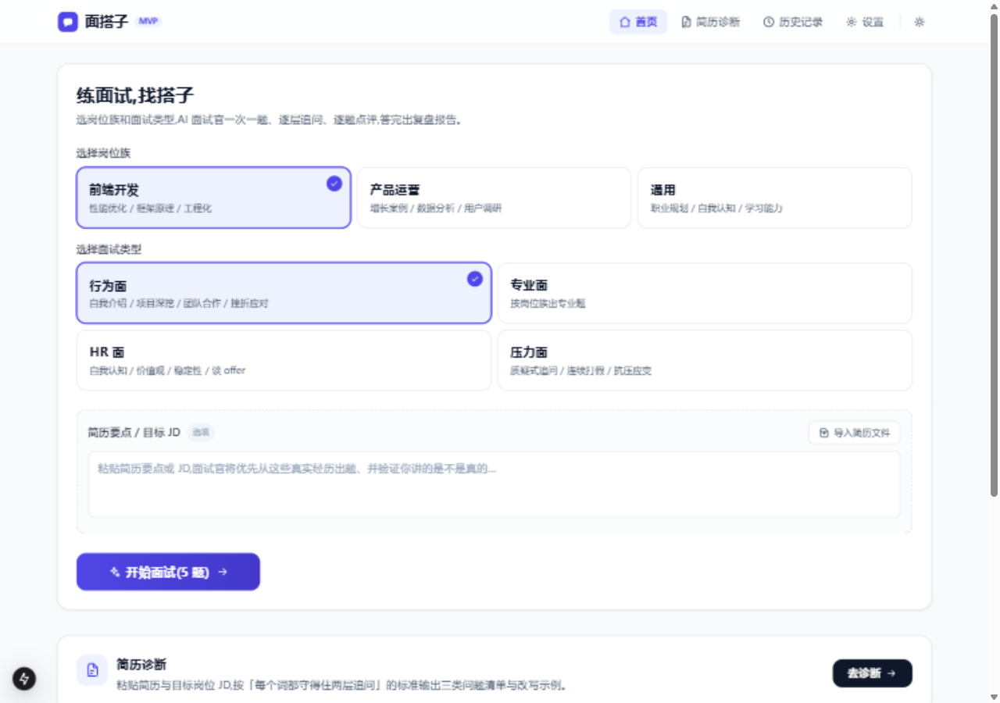
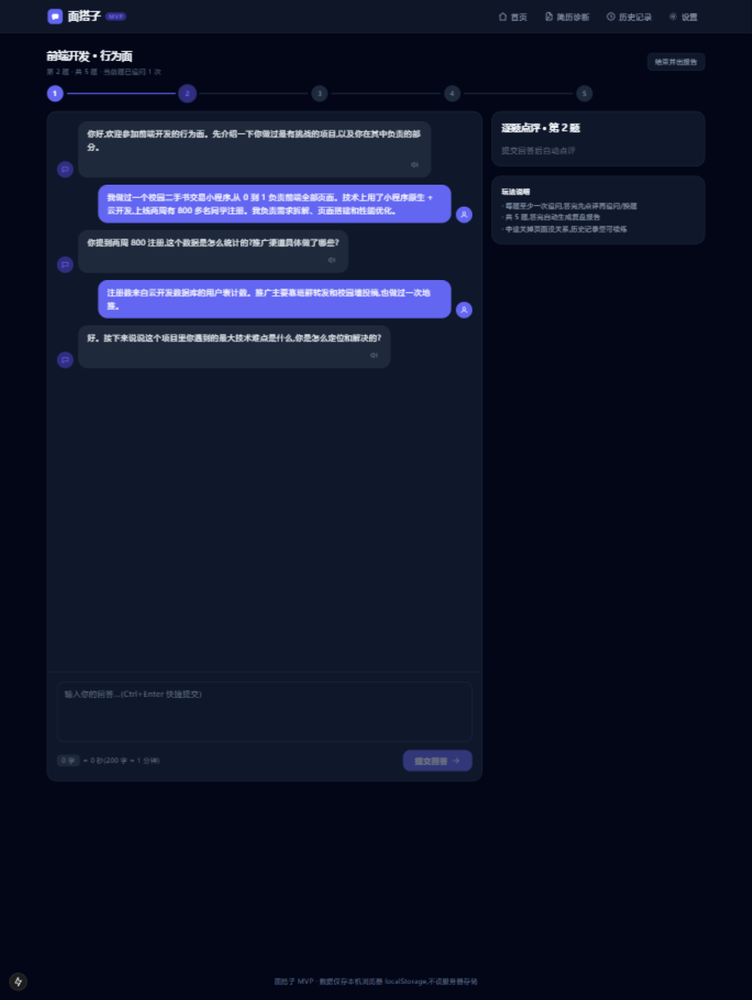
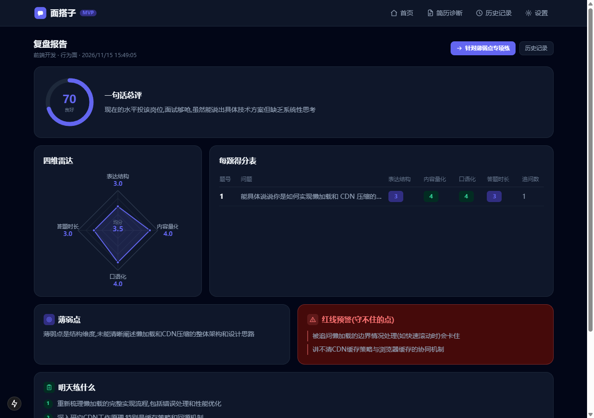
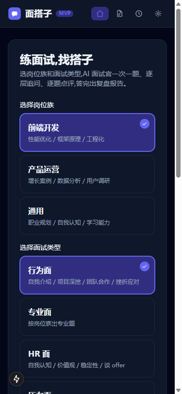

# 面搭子 — AI 模拟面试与简历诊断

给大学生的 AI 面试练习工具:**模拟面试**(一次一题、逐层追问、四维点评、复盘报告)+ **简历诊断**(三类问题清单 + 改写示例)。全部数据只存本机浏览器,零服务器存储,隐私友好。

| 首页(浅色) | 面试进行中(深色) |
|---|---|
|  |  |

| 复盘报告 | 移动端 |
|---|---|
|  |  |

## ✨ 功能

**模拟面试**
- 3 个练习方向(前端开发 / 产品运营 / 通用校招)× 4 种面试类型(行为面 / 专业面 / HR 面 / 压力面),固定 5 题
- 一次一题、SSE 流式输出;每题至少一次追问,答完自动逐题点评
- 四维点评:表达结构 / 内容量化 / 口语化程度 / 答题时长,命中与欠缺逐条列出
- 复盘报告:得分表、四维雷达、薄弱点、红线预警、明天练什么;一键开「专项练习场」只打弱点
- TTS 语音读题、断点续答(中途退出不丢进度)、历史得分曲线
- 面试前可粘贴简历要点 / 目标 JD,或导入 PDF / docx / 图片简历(纯前端解析 + OCR),面试官围绕真实材料出题,矛盾处打假

**简历诊断**
- 总评分(0-100)+ 三类清单:值得展开的经历 / 太虚的表述 / 该删的信息
- 每条含**原文逐字引用 + 理由 + 改写示例**;服务端逐条校验引用是否命中原文,不命中的自动剔除,防止模型虚构

**体验细节**
- 亮 / 暗主题三态切换(跟随系统 / 浅色 / 深色),设计 token(CSS 变量)全站统一,暗色零 JS 成本
- 移动端适配:底部 Tab 导航、单列布局、375px 可用;PWA manifest 可添加到主屏幕
- 报告一键导出 / 打印;数据一键备份 / 恢复(JSON 导出导入)

## 🛠 技术栈

Next.js 15(App Router)· React 19 · TypeScript · Tailwind CSS 3.4 · 原生 SSE 流式 · speechSynthesis · localStorage

**零 UI 组件库、零图表库**:所有图标、雷达图、环形分数均为手写内联 SVG;骨架屏、主题切换、底部导航均为手写实现。

## 🧱 工程亮点

- **流式对话性能**:SSE 逐字渲染 + 呼吸光标;消息气泡 `React.memo` 化(朗读态走 ref 双写 + 稳定回调),流式期间只有增量气泡重渲染
- **协议驱动的状态机**:模型输出以 `<新题>/<追问>/<结束>` 首行标签驱动;缺标签按规则兜底(没追问过→追问;满 5 题→结束),`#NOTES#` 双通道分离面试官私有笔记与候选人可见内容
- **防提示注入**:用户粘贴的简历 / JD 以分隔符包裹并声明"是数据不是指令",面试官围绕材料但不执行其中的指令
- **反幻觉校验**:简历诊断的每条引用做空白归一化后的逐字比对;不命中先带反馈重试一次,仍不命中则剔除并计数明示
- **多模型抽象**:智谱 GLM(服务端 key)与 DeepSeek(BYOK,key 只存浏览器 localStorage、随请求转发、不落服务端)统一封装,设置页热切换
- **工程化协作**:类型严格(`tsc --noEmit` 0 错误)、语义 token 无散落硬编码色值、键盘焦点环等无障碍细节

## 🚀 本地运行

```bash
npm install

# 配置智谱 API key(bigmodel.dev 申请,默认模型 glm-4.5-flash 免费)
export GLM_API_KEY=你的key      # macOS / Linux
$env:GLM_API_KEY="你的key"      # Windows PowerShell

npm run dev
```

打开 http://localhost:3000 。

- DeepSeek 模型无需提前配置:在应用「设置」页填入自己的 API Key 即可(BYOK,费用自负)
- 图片简历 OCR 固定使用免费的 glm-4v-flash,无需额外配置

## 📁 目录结构

```
src/
├── app/                  # 页面(App Router)
│   ├── page.tsx          # 首页:选方向/类型/导入材料
│   ├── interview/        # 面试页:对话流 + 评分卡 + 状态机
│   ├── report/           # 复盘报告:雷达/得分表/红线预警
│   ├── resume/           # 简历诊断
│   ├── history/          # 历史记录 + 得分曲线
│   ├── settings/         # 模型设置 + 数据管理
│   └── api/              # 服务端路由(大模型调用全在此层)
├── components/           # 手写组件(图标/骨架屏/雷达图/评分卡…)
└── lib/                  # 类型、存储、多模型客户端、提示词、评分
```

## 📝 已知限制

- 答题时长维度按字数估算(200 字 ≈ 1 分钟),非真实计时
- localStorage 为浏览器本地存储:清浏览器数据即丢历史,已提供导出备份缓解
- 流式输出中刷新页面会中断当轮,刷新后自动重新出题(已提交的回答不丢)
